# 데이터 패킷 러너

> 장애물을 넘어 데이터를 목적지 서버까지 전달하라!

데이터·정보보안 체험 부스용 미니게임입니다. 관람객은 인터넷 공간을 달리는 데이터 패킷이 되어 네트워크 장애물을 피하고, 데이터 조각을 모아 3분 안에 목적지 서버까지 전달합니다. 이 과정에서 데이터가 지연·유실될 수 있고, 안정적으로 전달하려면 재전송 같은 처리가 필요하다는 점을 체험합니다.

**Python + [Arcade](https://api.arcade.academy/) 3**로 만들었으며, 현재는 **프로토타입** 단계입니다. 기획은 [`계획.md`](계획.md), 구현 계획은 [`구현계획.md`](구현계획.md)에 있습니다.

| 시작 화면 | 튜토리얼 ① 조작 연습 |
|---|---|
|  | 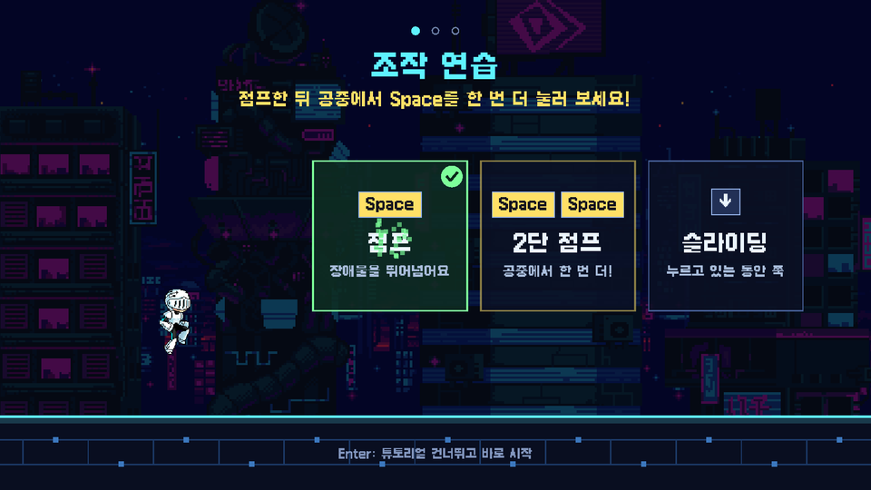 |
| **튜토리얼 ② 피해야 할 장애물** | **튜토리얼 ③ 모으면 좋은 아이템** |
| 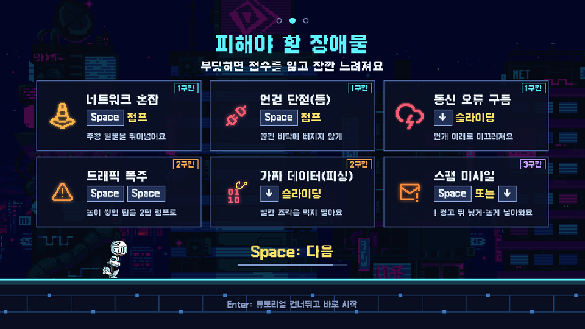 | 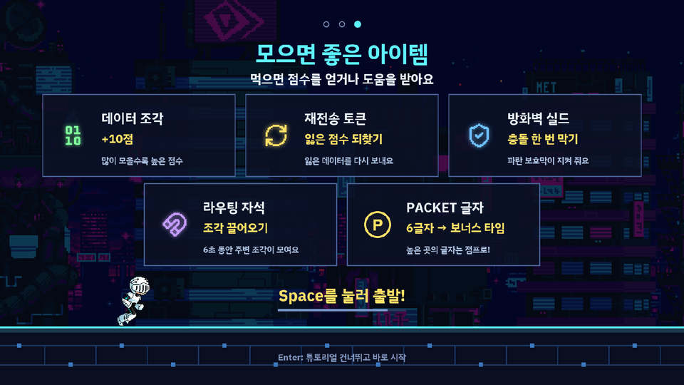 |
| **게임 화면** | **2구간: 트래픽 폭주를 2단 점프로** |
| 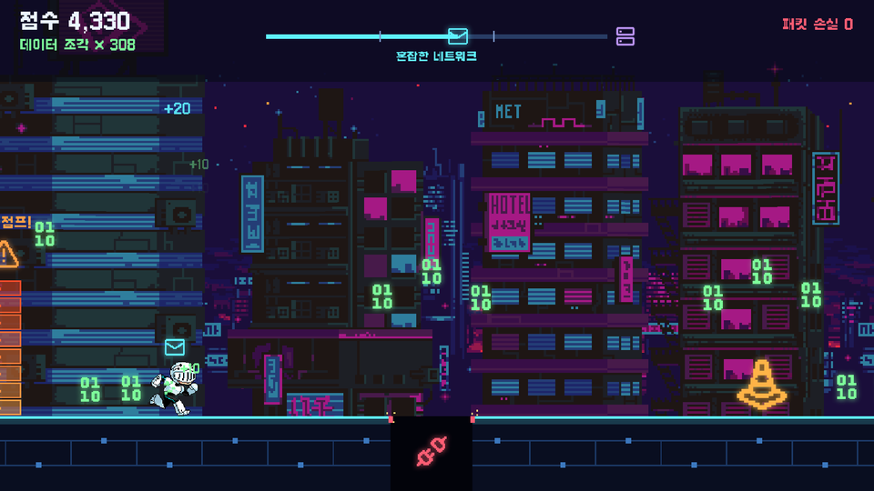 | 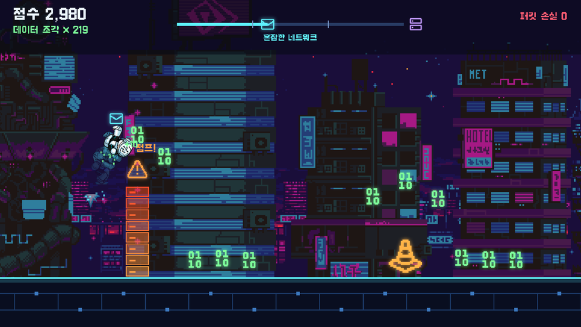 |
| **3구간: 오류 구름 번개 기둥** | **가짜 데이터(피싱)를 피하라** |
| 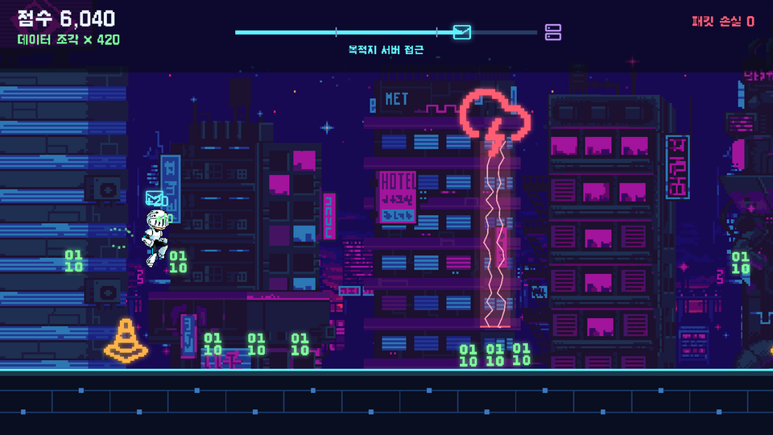 | 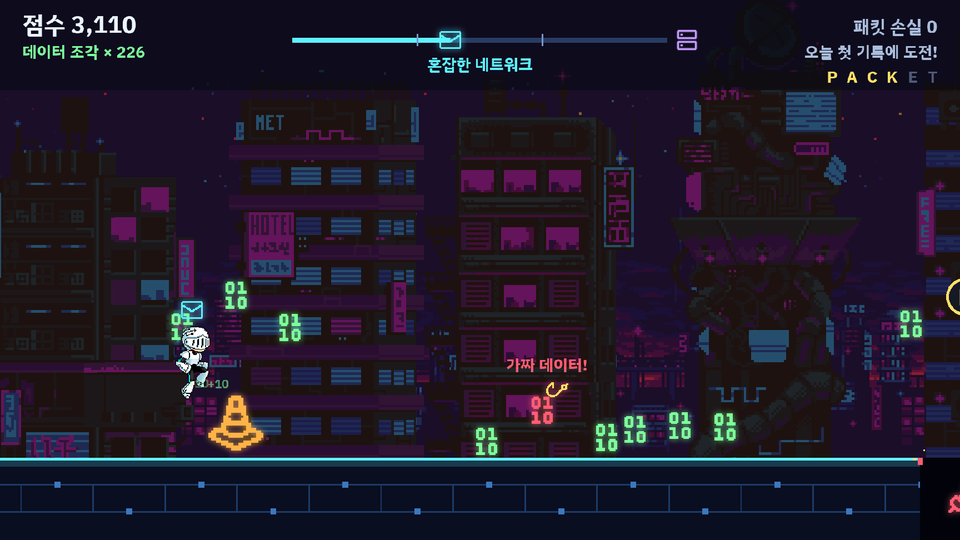 |
| **라우팅 자석 · 방화벽 실드** | **스팸 미사일 (! 경고 뒤 날아옴)** |
| 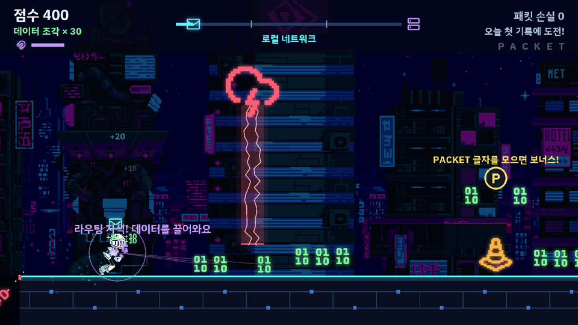 | 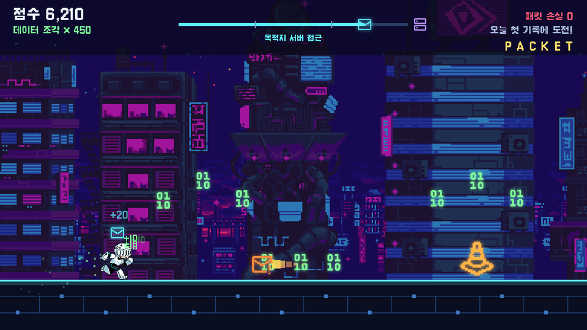 |
| **PACKET 글자를 다 모으면 보너스 타임** | **결과 화면** |
| 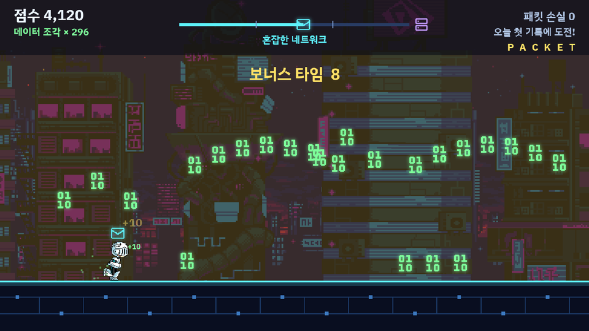 | 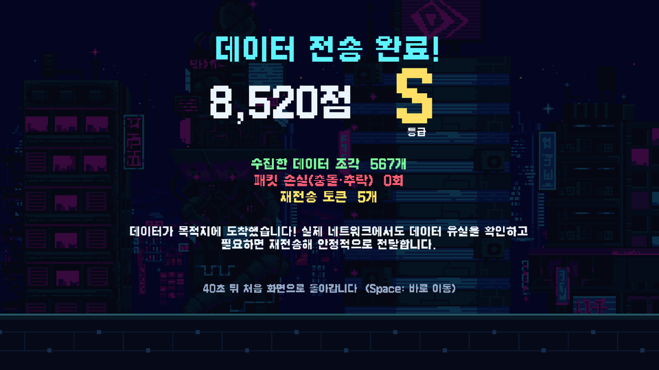 |
| **오늘의 TOP 10** | |
| 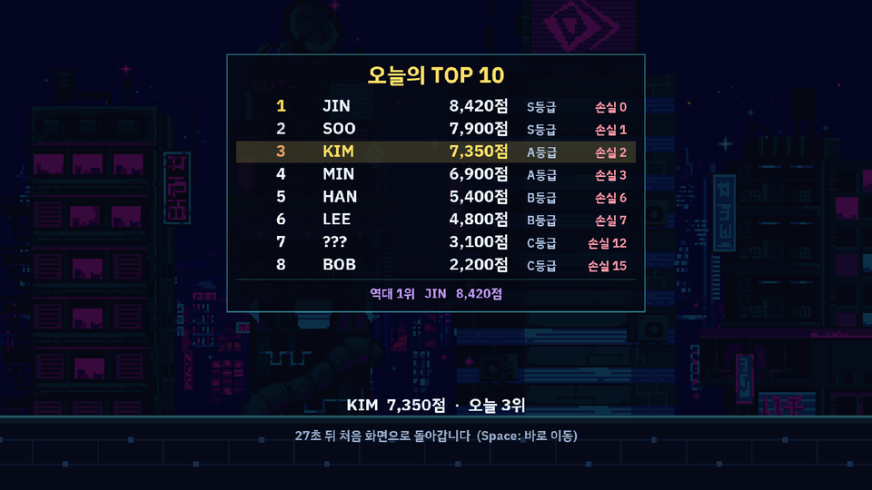 | |

---|---|
|  |  |
| **2구간: 트래픽 폭주를 2단 점프로** | **3구간: 오류 구름 번개 기둥** |
|  |  |
| **가짜 데이터(피싱)를 피하라** | **라우팅 자석 · 방화벽 실드** |
|  |  |
| **스팸 미사일 (! 경고 뒤 날아옴)** | **PACKET 글자를 다 모으면 보너스 타임** |
|  |  |
| **결과 화면** | **오늘의 TOP 10** |
|  |  |

---

## 실행 방법

**필요한 것:** Python 3.10 이상

```bash
pip install -r requirements.txt
python main.py               # 창 모드 (모니터보다 크면 자동으로 줄어듦)
python main.py --fullscreen  # 전체 화면
python main.py --booth       # 부스 운영 모드: 전체 화면, 마우스 커서 숨김, 개발용 키(F3·F11) 끔
python main.py --autoplay    # 자동 플레이 (테스트·데모용, 튜토리얼 없이 바로 시작)
```

부스 PC(Windows)에서는 `run_booth.bat`을 더블클릭하면 부스 운영 모드로 실행됩니다.

게임 화면은 **1920×1080** 기준으로 그려집니다. 창 크기나 모니터 해상도가 달라도 비율을 유지한 채 확대·축소되고, 남는 부분은 검은 여백으로 채워집니다.

## 조작법

| 키 | 동작 |
|---|---|
| **Space** (또는 ↑) | 점프 — 착지 직전에 눌러도 착지하자마자 점프 |
| 공중에서 **Space** 한 번 더 | **2단 점프** — 발밑 폭발과 함께 앞으로 공중제비. 점프 한 번에 1회, 착지하면 다시 사용 가능 (틈에 빠지는 중에도 사용 가능) |
| **↓** 누르고 있기 | 슬라이딩 — 떼면 일어남 (최소 0.25초 유지). 오류 구름 아래에서는 떼도 구름을 지날 때까지 계속 미끄러짐 |
| 공중에서 **↓** | 빨리 떨어지기 → 착지하자마자 슬라이딩 |
| 슬라이딩 중 **Space** | 바로 점프. 단, 오류 구름 아래나 바로 앞에서는 구름을 지날 때까지 점프를 보류 (연타해도 구름에 부딪히지 않음) |
| **Enter** (튜토리얼 중) | 튜토리얼을 건너뛰고 바로 시작 |

**운영·개발용 키** (화면에는 안내하지 않음)

| 키 | 동작 |
|---|---|
| ESC (3초 누르기) | 게임 종료 — 관람객이 실수로 끄지 않도록 3초 동안 누르고 있어야 함 (누르는 동안 화면 아래에 남은 시간 표시) |
| F11 | 전체 화면 켜기/끄기 (`--booth`에서는 꺼짐) |
| F9 (시작 화면에서 3초 누르기) | 오늘 순위 초기화 — 지우기 전 파일을 `data/`에 백업 |
| F3 (`--booth`에서는 꺼짐) | 충돌 판정 상자 표시 (노랑 = 플레이어, 빨강 = 장애물, 초록 = 아이템). 판정은 그림보다 조금 안쪽으로 잡혀 있고, 원뿔은 모양을 따라 3단으로 좁아짐 |

## 게임 규칙

**진행** — 시작 화면 → 튜토리얼(약 20~30초) → 본게임 3분 → 결과 화면(요약 → 이름 입력 → 순위표, 약 40초) → 시작 화면으로 자동 복귀

**튜토리얼** — 시작 화면에서 Space를 누르면 세 단계로 안내합니다. Enter를 누르면 언제든 건너뛰고 바로 시작합니다.

1. **조작 연습** — 왼쪽의 캐릭터로 점프·2단 점프·슬라이딩(↓ 누르고 있기)을 직접 해 보면 카드에 체크가 켜집니다. 세 가지를 다 하면 바로 다음으로 넘어가고, 20초가 지나면 자동으로 넘어갑니다.
2. **피해야 할 장애물** — 장애물 6종의 모양, 눌러야 할 키, 처음 나오는 구간.
3. **모으면 좋은 아이템** — 아이템 5종의 효과. Space를 누르면 출발합니다.

2·3단계는 Space로 넘기거나 9초 뒤 자동으로 넘어갑니다. 연습하며 Space를 연타하다가 안내를 놓치지 않도록, 페이지가 바뀐 뒤 1초 동안은 Space로 넘어가지 않습니다.

| 구간 | 시간 | 내용 |
|---|---|---|
| 1. 로컬 네트워크 | 0~60초 | 느린 속도, 장애물 하나씩 |
| 2. 혼잡한 네트워크 | 60~120초 | 속도 상승, 장애물 2개 조합, **트래픽 폭주 첫 등장** |
| 3. 목적지 서버 접근 | 120~180초 | 가장 빠름, 장애물 3개 연속 조합, **스팸 미사일 첫 등장** |

**장애물과 아이템**

| 대상 | 피하는 방법 / 효과 |
|---|---|
| 🔶 네트워크 혼잡 (주황 콘) | 점프 |
| ⚡ 통신 오류 구름 (하늘에서 내려오는 번개 기둥) | 슬라이딩 — 점프·2단 점프로는 넘을 수 없음 |
| ⚠️ 트래픽 폭주 (높이 쌓인 패킷 탑) | **2단 점프** — 한 번 점프로는 높이가 모자람 |
| 🔌 연결 단절 (바닥 틈) | 점프 — 빠지면 끊긴 연결이 복구되고 그 자리에서 다시 달림 |
| 📧 스팸 미사일 (주황 편지) | 오른쪽 끝에 **! 경고**가 먼저 뜬 뒤 빠르게 날아옴. **낮게 오면 점프, 높게 오면 슬라이딩** (3구간부터) |
| 🎣 가짜 데이터 (피싱 미끼) | 진짜 데이터 조각과 똑같은 01/10 모양이지만 **빨간색 + 노란 낚싯바늘**. 진짜 조각 줄 사이에 살짝 높게 떠 있어 **슬라이딩(또는 점프)으로 피함**. 걸리면 −30점, 무사히 지나치면 +10점 (2구간부터) |
| 🟩 데이터 조각 (01/10) | +10점 |
| 🟨 재전송 토큰 | 충돌로 잃은 점수 1회분(최대 30점) 복구, 잃은 점수가 없으면 +10점 |
| 🛡️ 방화벽 실드 (파란 방패) | 충돌이나 추락을 **한 번** 막아 줌 (최대 15초, 끝나기 3초 전부터 깜빡임). 2구간부터 |
| 🧲 라우팅 자석 (보라 자석) | 6초 동안 앞쪽의 **진짜** 데이터 조각을 끌어옴 (가짜는 끌려오지 않음) |
| 🅿️ PACKET 글자 | 점프 궤적 꼭대기에 P·A·C·K·E·T가 차례로 나옴(놓치면 나중에 다시). **여섯 글자를 다 모으면 10초 보너스 타임** — 앞의 장애물이 데이터 조각으로 바뀌고 조각이 쏟아짐 (한 판에 한 번) |

아이템 효과가 켜져 있으면 점수 아래에 아이콘과 남은 시간 막대가 표시됩니다.

**점수**

| 이벤트 | 점수 |
|---|---|
| 데이터 조각 | +10 |
| 장애물 통과 | +20 |
| 충돌·추락 | −30 (0점 아래로 내려가지 않음) |
| 가짜 데이터(피싱)에 걸림 / 피함 | −30 / +10 (재전송 토큰으로 되찾을 수 없음) |
| 서버 도착 | +300 |

- **실수해도 게임이 끝나지 않습니다.** 충돌하면 잠시 느려지고 1.5초 동안 무적이 되며, 3분이 지나면 누구나 서버에 도착합니다.
- **등급(임시):** S 7,500점 이상 / A 5,500 / B 3,500 / C. 리허설 결과를 보고 `packet_runner/config.py`의 `GRADES`에서 조정합니다.
- 장애물은 무작위로 나오지만, **반드시 피할 수 있도록 검증된 패턴** 안에서만 고릅니다(`packet_runner/patterns.py`).

## 부스 운영 안전장치

- **연타 잠금** — 결과 요약·순위표는 3초, 시작 화면은 들어온 뒤 2초 동안 Space로 넘어가지 않습니다. 앞사람이 Space를 연타해도 결과를 건너뛰고 다음 판이 바로 시작되지 않습니다.
- **창 선택이 풀리면 일시정지** — 다른 창을 누르는 등으로 키 입력을 받을 수 없게 되면 게임·튜토리얼이 멈추고 "화면을 한 번 클릭해 주세요"가 뜹니다. 화면을 클릭하면 이어집니다.
- **자리 비움** — 게임 중 15초 동안 아무 키도 누르지 않으면 게임을 멈추고 "아직 하고 있나요?"를 묻습니다. 아무 키나 누르면 이어서 하고(이때 누른 키는 점프로 쓰지 않음), 10초 더 입력이 없으면 기록을 남기지 않고 시작 화면으로 돌아갑니다.
- **잘 보이는 화면** — 게임 중에는 배경을 어둡고 덜 화려하게 바꿔 장애물·아이템이 눈에 띄게 했고, 위쪽 정보 글자는 모두 24px 이상입니다. 패킷 손실은 0일 때 회색이고, 늘어날 때만 빨갛게 번쩍입니다.
- 자동 플레이(`--autoplay`)에는 자리 비움·일시정지가 적용되지 않습니다.

## 로컬 랭킹

- **오늘의 TOP 10**을 보여 줍니다. 날짜가 바뀌면 오늘 순위는 새로 시작하고, 지난 기록은 **역대 1위**로만 남습니다.
- 순위는 점수 → 패킷 손실이 적은 순 → 먼저 달성한 순입니다.
- **이름은 TOP 10에 들었을 때만** 영문 3자로 입력합니다. 한/영 키 상태와 관계없이 A~Z 키로 입력되고, 15초 안에 확정하지 않으면 입력한 글자 뒤를 `-`로 채워(아무것도 없으면 `???`) 저장합니다. 부적절한 약어는 `config.py`의 `BANNED_NAMES`로 막습니다.
- TOP 10 밖이면 이름 입력 없이 "오늘 N위 · TOP 10까지 몇 점"을 보여 줍니다.
- 시작 화면은 제목과 오늘의 순위표를 8초마다 번갈아 보여 주고, 게임 중에는 오른쪽 위에 **오늘 최고 점수**가 도전 목표로 표시됩니다.
- 기록은 `data/ranking.json`에 저장됩니다(git에는 올라가지 않음). 저장할 때마다 직전 파일을 `ranking.json.bak`으로 남기고, 파일이 깨져 있으면 `ranking_broken_날짜.json`으로 옮긴 뒤 새로 시작합니다. 행사가 끝나면 `data` 폴더를 지우거나 보관하세요(이름 3자 외의 개인정보는 저장하지 않습니다).

## 프로젝트 구조

```
main.py                     실행 진입점
packet_runner/
├─ config.py                화면·속도·점수·시간 등 모든 조정값
├─ app.py                   게임 창, 1920×1080 화면 맞춤(레터박스)
├─ player.py                플레이어 움직임(점프·슬라이딩·판정)과 그림
├─ patterns.py              장애물 패턴, 속도 곡선, 회피 가능 간격 규칙
├─ world.py                 장애물·아이템·바닥 틈 생성과 이동
├─ scoring.py               점수·등급·재전송 토큰·피싱 계산
├─ powerups.py              아이템 효과 상태 (방화벽 실드, 라우팅 자석)
├─ bonus.py                 PACKET 글자 모으기·보너스 타임 상태
├─ ranking.py               로컬 랭킹 저장·순위 계산·이름 규칙
├─ ranking_board.py         순위표 그리기 (시작·결과 화면 공용)
├─ background.py            Warped City 3겹 패럴랙스 배경, 케이블 바닥
├─ effects.py / hud.py      입자·점수 글자 / 상단 정보 표시
├─ autopilot.py             자동 플레이
├─ tutorial.py              튜토리얼 조작 연습 판정
├─ booth.py                 운영자 키 누르고 있기·자리 비움 판정
└─ views/                   시작·튜토리얼·게임·결과 화면
assets/
├─ source/                  원본 에셋 (러너 시트, Warped City 배경, Lucide 아이콘)
├─ generated/               게임에서 쓰는 변환된 이미지
├─ fonts/                   Galmuri11 글꼴
├─ licenses/                에셋 라이선스 원문
└─ CREDITS.md               에셋 출처
tools/build_assets.py       source → generated 변환 스크립트
tests/                      단위 테스트
```

## 개발

**난이도 조정** — 대부분 `packet_runner/config.py`의 값만 바꾸면 됩니다.

| 바꾸고 싶은 것 | 설정 |
|---|---|
| 구간별 속도 | `SPEED_KEYS` |
| 점프 높이·체공 시간 | `GRAVITY`, `JUMP_VELOCITY`, `DOUBLE_JUMP_VELOCITY` |
| 판정 크기 | `STAND_BOX`, `SLIDE_BOX`, `CONGESTION_TIERS`, `SPIKE_HIT_W`, `CLOUD_HIT_W` (그림·간격 계산용 크기는 `CONGESTION_BOX`, `SPIKE_BOX`, `CLOUD_W`) |
| 패턴 사이 쉬는 시간 | `ZONE_REST` |
| 충돌 후 감속·무적 시간 | `HIT_SLOW`, `HIT_SLOW_TIME`, `INVINCIBLE_TIME` |
| 점수·등급 | `SCORE_*`, `GRADES` |
| 튜토리얼 시간 | `TUTORIAL_PRACTICE_TIME`, `TUTORIAL_PAGE_TIME`, `TUTORIAL_LOCK` |
| 부스 운영 시간 | `QUIT_HOLD`, `TITLE_INPUT_LOCK`, `RESULT_SKIP_LOCK`, `IDLE_WARN`, `IDLE_GRACE` |
| 게임 중 배경 밝기 | `BG_GAME_TINT` |

새 장애물 패턴은 `patterns.py`의 `PATTERNS`에 추가합니다. 간격이 너무 좁으면 테스트가 실패합니다.

**테스트**

```bash
pip install pytest
pytest
```

점수 계산, 랭킹 저장·순위·이름 규칙·깨진 파일 복구, 모든 패턴의 회피 가능 간격, 오류 구름이 슬라이딩을 강제하는지(2단 점프로도 못 넘는지), 트래픽 폭주가 2단 점프를 강제하는지(두 번째 Space를 0.1~0.6초 사이 언제 눌러도 넘는지), 점프·2단 점프·슬라이딩·바닥 틈 처리, 튜토리얼 조작 연습 판정, 운영자 키 누르고 있기·자리 비움 판정을 검사합니다.

**에셋 다시 만들기** — `assets/source`의 원본을 바꿨을 때만 필요합니다.

```bash
pip install cairosvg   # 아이콘 변환에 필요 (시스템에 cairo 라이브러리 필요)
python tools/build_assets.py
```

## 프로토타입 범위

구현되어 있는 것과 [`구현계획.md`](구현계획.md) 기준으로 아직 남은 것입니다.

- [x] 자동 달리기, 점프·슬라이딩, 3종 장애물, 데이터 조각·재전송 토큰
- [x] 3구간 난이도, 회피 가능 패턴, 충돌 감속·무적, 추락 후 재시작
- [x] 점수·등급, 서버 도착 연출, 결과 화면 40초 후 자동 복귀
- [x] 1920×1080 화면, 한글 글꼴, 패럴랙스 배경
- [x] 튜토리얼 화면 (조작 연습 → 장애물 → 아이템, Enter로 건너뛰기)
- [x] 로컬 랭킹 (오늘 TOP 10, 이름 영문 3자, 운영자 초기화)
- [x] 추가 장애물·아이템 1차: 피싱 미끼, 방화벽 실드, 라우팅 자석 (구현계획 §15)
- [x] 추가 장애물·아이템 2차: 스팸 미사일, PACKET 글자 → 보너스 타임
- [x] 부스 안전장치: ESC 3초 종료, `--booth` 모드, 연타 잠금, 창 선택 해제 시 일시정지, 자리 비움 시 시작 화면 복귀
- [x] 가독성: 게임 중 배경 어둡게, HUD 글자 키우기, 패킷 손실 표시 정리
- [ ] 오류 발생 시 자동 복구
- [ ] 효과음·배경음
- [ ] UI/UX 보완 (구현계획 §16: 게임 속 첫 만남 안내, 맞춤 학습 메시지, 입력 안전장치 등)
- [ ] 부스 리허설 후 속도·간격·등급 조정

## 크레딧

- 캐릭터: **Animated Runner Character** — irmirx (CC0)
- 슬라이딩 동작: 위 캐릭터를 바탕으로 팀이 **ChatGPT 이미지 생성 기능**으로 만든 그림 (AI 생성 이미지)
- 2단 점프 공중제비: 위 캐릭터를 바탕으로 팀이 **ChatGPT 이미지 생성 기능**으로 만든 그림 (AI 생성 이미지)
- 배경: **Warped City** — Luis Zuno / ansimuz (CC0)
- 아이콘: **Lucide** (ISC)
- 글꼴: **Galmuri11** — Lee Minseo (SIL OFL 1.1)

자세한 출처와 변경 사항은 [`assets/CREDITS.md`](assets/CREDITS.md)를 참고하세요.
